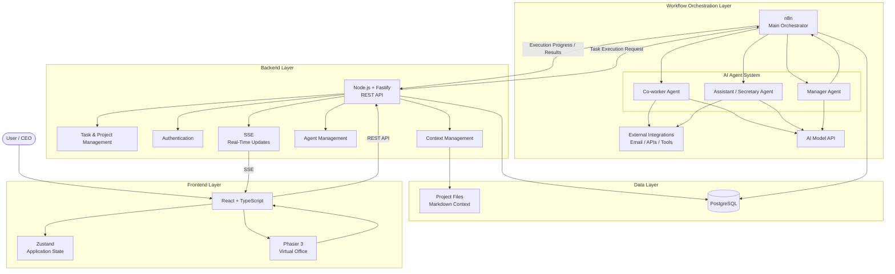

# Sleeply — MVP Summary

An AI Agent That Works With You, Even While You Sleep.

## 1. Main Concept

Sleeply is an AI-powered workspace designed to extend human productivity through a digital team of specialized AI agents.

It learns from the user's work context, understands their workflows, and executes assigned tasks according to their specific instructions, methods, and objectives.

While the user sleeps or focuses on other priorities, Sleeply can organize information, manage communications, prepare tasks, and advance ongoing projects.

Its purpose is not to replace human effort or make independent decisions, but to work alongside the user, extend their capabilities, and help them achieve more without sacrificing the rest they need.

## 2. MVP Overview

Sleeply combines three essential components:

1. Interactive Virtual Office

A 2D isometric pixel-art environment where users interact with their digital workforce, visualize agent activities, assign tasks, and monitor progress.

2. Multi-Agent AI System

Three specialized agents collaborate to execute tasks, manage information, coordinate activities, and advance the user's projects.

3. Context and Workflow Orchestration

A central backend, PostgreSQL, and n8n coordinate task execution, maintain project context, and synchronize agent activity.

## 3. Core AI Agents

| Agent                 | Main responsibility                                                                |
| --------------------- | ---------------------------------------------------------------------------------- |
| Co-worker             | Executes assigned tasks and advances projects.                                     |
| Assistant / Secretary | Organizes emails, messages, information, and administrative activities.            |
| Manager               | Monitors executions, coordinates tasks, identifies problems, and reports progress. |

The user is represented by a CEO character inside the virtual office.

## 4. Operating Modes

Awake Mode — Co-pilot

- Assign tasks.

- Interact with agents.

- Review suggestions.

- Monitor progress.

- Manage projects.

Sleep Mode — Autonomous

- Execute assigned tasks.

- Process workflows.

- Advance projects.

- Monitor failures.

- Prepare morning reports.

## 5. Proposed MVP Architecture

Diagram:

### Technology stack

| Layer               | Technology                      |
| ------------------- | ------------------------------- |
| Frontend            | React, TypeScript, Tailwind CSS |
| Virtual environment | Phaser 3                        |
| Backend             | Node.js, TypeScript, Fastify    |
| Database            | PostgreSQL                      |
| ORM                 | Prisma or Drizzle               |
| Automation          | n8n                             |
| AI                  | External AI APIs                |
| Communication       | REST API + SSE                  |
| Deployment          | Docker + Docker Compose         |
| Local integration   | Tauri (future phase)            |

## 6. Main MVP Functionalities

1. User registration and authentication.

2. Interactive virtual office with basic characters and workstations.

3. Three functional AI agents.

4. Project and task management.

5. Agent assignment and execution.

6. Workflow orchestration through n8n.

7. Structured user and project context.

8. Document uploads and controlled file access.

9. Asynchronous task execution.

10. Real-time agent activity and progress visualization.

11. Awake Mode and Sleep Mode.

12. Execution history, notifications, and morning reports.

## 7. Data and Context Management

PostgreSQL will manage the platform's structured information, including:

- Users and agent configurations.

- Projects and tasks.

- Execution records and history.

- Agent instructions.

- Notifications.

- Project context and file metadata.

Agent memory will use structured information and Markdown documents rather than vector databases or embeddings.

Local computer integration will initially be limited to user-approved file uploads. A lightweight desktop application can be introduced later to provide controlled access to local projects and applications.

## 8. MVP Development Roadmap

| Phase                  | Main objective                                    |
| ---------------------- | ------------------------------------------------- |
| 1. Foundation          | Backend, database, authentication.                |
| 2. Task Management     | Projects, agents, tasks, and execution states.    |
| 3. AI Integration      | n8n and first functional Co-worker Agent.         |
| 4. Multi-Agent System  | Secretary, Manager, and coordination.             |
| 5. Virtual Office      | Phaser environment and activity visualization.    |
| 6. Sleep Mode          | Autonomous execution and morning reports.         |
| 7. Context Integration | Project memory, documents, and local integration. |

## 9. MVP Success Criteria

The MVP should demonstrate one complete operational scenario:

The user assigns a task to an AI agent, provides the necessary instructions and project context, activates Sleep Mode, and leaves the platform.

Sleeply executes the task asynchronously, monitors progress, saves the deliverable, and prepares a report for the user.

When the user returns, they can review the completed work, validate the results, and continue their projects.

## Final Project Definition

Sleeply is an AI-powered digital workspace that transforms a traditional assistant into a collaborative virtual workforce. Through specialized AI agents, personalized working context, and automated workflows, it enables users to delegate tasks, advance projects, and manage responsibilities while sleeping or focusing on other priorities.

Its interactive virtual office provides a visual environment to manage this workforce, while its backend and orchestration infrastructure ensure that agents operate according to the user's instructions, methods, permissions, and goals.

Core philosophy: Work alongside AI, extend your capabilities, and never sacrifice the rest you need.

## 10. Estado de Validación y Entrega Final

- **Estado:** Tarea terminada con éxito.
- **Comentario de Cierre:** Tarea terminada con éxito. Arquitectura multiagente desplegada en n8n con Meta AI, chat conversacional conectado en la oficina web para el Agente Principal (Alex Vance), paneles interactivos de asignación para Co-worker (Sam Rivera), Secretaria (Taylor Chen) y Manager (Jordan Díaz), y sincronización verificada en repositorios de GitHub y Google Drive.
- **Cumplimiento de Restricciones:** Cero emojis en reportes y respuestas. Conexiones n8n validadas en vivo.

